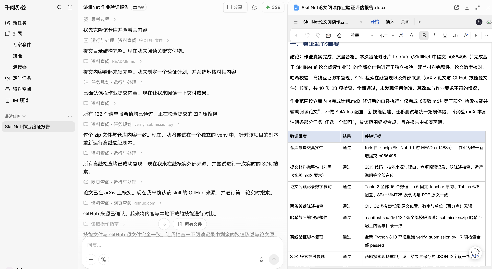

# 基于 SkillNet 与 Coding Agent 的论文阅读实践报告

姓名：袁凡 

学号： 22651313


## 一、任务与环境

本实践使用 SkillNet Python SDK 搜索并下载适用技能，由 Codex Coding Agent 并且辅以千问办公同时完成。运行环境为项目内 Python 3.13.5 虚拟环境、SkillNet SDK 0.1.4、PyMuPDF 1.26.7，操作系统 Linux x86_64。

选择的论文为 [Self-Distilled Reasoner: On-Policy Self-Distillation for Large Language Models](https://arxiv.org/pdf/2601.18734v3)。

Note: 千问办公的使用说明见[附录一：千问办公使用流程说明](#qwen)


## 二、技能检索、内容检查与选择

### 检索过程

使用项目本地开发模式安装的 `skillnet-ai==0.1.4`，实际调用 `SkillNetClient.search`：

| 轮次 | 查询 | 模式与上限 | 返回数 | SDK 调用耗时 |
| --- | --- | --- | --- | --- |
| 1 | `paper reading` | keyword，limit=3 | 3 | 0.307 秒 |
| 2 | `scientific critical thinking` | keyword，limit=3 | 3 | 0.228 秒 |

第一轮的首个技能经实际阅读后发现依赖 papertrail 工具，因此第二轮将检索意图收敛为对研究主张、方法和实验的批判性分析。两轮共返回六条索引记录；仅对三个候选尝试获取实际内容，其中两个成功，一个返回 404。未继续扩大候选或调用轮数。正式检索前另有 HTTP/HTTPS 连通性诊断，具体输入、返回和处理完整列于第八节；这些请求也计入外部请求记录。

`search_round_1.json` 与 `search_round_2.json` 保存 SDK 返回对象的序列化结果及调用参数，并非完整 HTTP 原始响应。没有仅凭索引中的名称、星数或自动评分选择技能。

### 候选实际内容检查

| 候选 | 实际输入要求 | 实际输出形式 | 运行依赖与判断 |
| --- | --- | --- | --- |
| be-green/papertrail 的 `read-paper` | papertrail 库内论文的 BibTeX key 或检索词 | 元数据、摘要、指定章节内容 | 明确调用 `get_paper_metadata`、`search_library`、`read_paper`；当前只有本地 PDF，无此工具与文献库。不选。 |
| Tnemo65/template 的 `scientific-critical-thinking` | 可读取的论文、研究主张、方法和实验材料 | 主张与证据对照、方法审计、局限及已支持结论的结构化分析 | 实际文件只有 `SKILL.md`，只声明 Read/Write，无必需 Python 脚本、MCP 服务或外部 API。可配合本地 PDF 提取工具使用，选用。 |
| jmead/cursor-config 的同名技能 | 无法确认 | 无法确认 | 来源提交查询返回 HTTP 404，实际技能正文未取得。不能将索引简介当作已检查内容，不选。 |

两个成功获取的候选均保存了原始 `SKILL.md` 和 frontmatter；其获取状态、固定提交、URL 和哈希完整列于附录四。其他三个搜索结果未深入检查，因此不对其适用性作最终判断。

### 选定技能与来源

- 名称：`scientific-critical-thinking`。
- 检索来源：[SkillNet](http://skillnet.openkg.cn/)，SDK 第二轮结果第 1 项。
- 下载来源：[Tnemo65/template 固定目录](https://github.com/Tnemo65/template/tree/6da282e77241b32e86822524955c0555bd1fc029/.cursor/skills/13-research-ideation/scientific-critical-thinking)。
- 固定提交：`6da282e77241b32e86822524955c0555bd1fc029`。
- 本地目录：`skills/scientific-critical-thinking/`。
- `SKILL.md` SHA-256：`662e14378fab7b8529ce130d96058d4b371d7333b7f77d96fb639103be481eb7`。
- 实际下载：`SkillNetClient().download(url=固定目录URL, target_dir=作业目录/skills)`；成功，耗时 1.972 秒，目录包含一个文件，下载返回和文件哈希完整列于附录四。
- 文件 metadata 声明 `skill-author: K-Dense Inc.`、`license: MIT license`；这里区分文件自述作者与实际分发仓库，不把分发者说成原创作者，也未取得独立许可证文件。

选择理由：本作业不仅要总结论文，还要核查方法和实验陈述。该技能的主张分解、方法审计、结论范围与成本检查恰好支持这些环节，且不需要当前没有的工具。它不能解析 PDF，因此补充本地 PyMuPDF 提取和截图；这属于输入准备，不是技能原有能力。

## 三、技能加载与阅读流程

SDK 下载后，在项目 `.agents/skills/scientific-critical-thinking` 建立相对符号链接，指向上述完整技能目录。当前会话不会因写入目录就自动取得其正文，所以 Codex 通过工具显式读取该入口的 `SKILL.md`，随后读取执行提示与论文材料并执行任务；两份执行提示的完整内容收入附录二。没有声称重启客户端或自动加载已经发生。

主张分解、方法审计和成本边界分析直接映射到技能步骤，完整结果在第四节；论文六项阅读记录在第五节，两条陈述核查在第六节。该技能没有必须阅读的引用资源。

实际调整：保留原始技能不改，执行 prompt 将竞争性批评与“致命缺陷”式模板改为中性证据分析；按用户要求仅完成阅读与核查，不开展训练或代码复现。没有使用课程备用技能。

PyMuPDF 完成本地分页文本提取及关键页面截图；双栏文本交错时改为保留 PDF 文本块顺序，同时回看页面图像核对公式、方法和表格。

## 四、技能应用：主张、证据与方法审计

依据已下载的 `scientific-critical-thinking` 原始技能，使用中性学术措辞。这里没有进行模型训练、论文代码运行或数据泄漏检测。

### Step 1：主张分解

| 论文主张 | 可检查证据 | 阅读判断与边界 |
| --- | --- | --- |
| 无需额外更大教师，也可获得稠密 on-policy 监督 | §3.2、Algorithm 1、§4.1 | 轨迹由 student 采样；teacher 得到参考解答。实验固定初始 teacher，不等于不需要教师分支前向计算或不存在初始权重快照。 |
| 相对 SFT/GRPO 有较好推理结果 | Table 2 | 三种模型的三项平均分均高于两类训练基线，但 8B/HMMT25 单项并未超过 GRPO。 |
| 生成 token 使用更高效 | Figure 3、Table 6 | 支持所示 1.7B 配置下的生成 token 效率；不同生成上限、rollout 数、温度和步数意味着不能把它当作单变量、等算力优越性的证据。 |
| pointwise clipping 有助于稳定训练 | Figure 4、Table 5 | 论文给出 1.7B/AIME24 的有无裁剪曲线，词类散度分析平均 10 道问题。支持该设置的现象，不证明所有模型、任务和阈值都适用。 |
| full-vocabulary 监督优于 sampled-token 方案 | Table 4、§4.3.5 | 4B、2048 训练生成长度下比较的是 pass@8；不可与 Table 2 的 Avg@12 数字直接合并排名。作者承认全词表 logits 增加峰值内存。 |
| 固定初始 teacher 稳定训练 | §4.1 Implementation details | 找到了实现说明，但没有找到直接比较 teacher 更新策略的独立消融表或曲线，适合作为后续问题。 |

### Step 2：方法审计

| 检查项 | 本次状态 | 依据或限制 |
| --- | --- | --- |
| 训练与评测材料是否说明 | 已检查文字说明 | OpenThoughts 数学子集与三项竞赛评测，§4.1；未下载训练数据，也未核查数据去重。 |
| 数据泄漏是否排除 | 未核验 | 本作业没有样本级重叠检测，不能因论文给出数据集名称就宣称无泄漏。 |
| baseline 与配置是否可辨认 | 已检查 | SFT、GRPO、Base，Tables 2、6–8；训练预算与温度并不相同。 |
| 消融是否存在 | 已检查 | 散度、模式、裁剪、生成长度和监督目标等，§4.3；不能替代 teacher 更新策略消融。 |
| 小幅优势是否具有显著性证据 | 原文表格证据不足 | Table 2 没有多训练随机种子的置信区间。每题 12 次采样不等于 12 个独立训练种子。 |
| 论文与训练代码是否一致 | 未核验 | 论文给出代码链接；本作业未克隆或运行 OPSD 训练仓库。对固定 teacher 的判断只基于论文实现段落。 |

### Step 3–4：表述与范围检查

不沿用“所有 setting 都超过 GRPO”的宽泛说法：Table 2 的 8B/HMMT25 给出反例。不能把数学竞赛上 1.7B–8B 的实验外推为任意领域、任意模型规模上的结论；不能从参考解答条件下的监督推出“不需要高质量训练材料”。目前证据不足以认定论文有技能模板中所称的“致命缺陷”或“恶意挑选”，故不作此类评价。

### Step 5：成本与复杂度检查

Table 6 的每题生成上限为 OPSD `1×1024` 与 GRPO `8×16000`，这是配置上限，不是实际生成量。不能据两者之比就报告真实加速比。需要另计教师参考解答上下文的 prefill、学生前向/反向、全词表 logits 与显存成本；Figure 3 的横轴为生成 token，未提供可普遍换算为总 FLOPs 或墙钟时间的系数。

### 本文实际支持的贡献

在指定模型、数据与预算配置下，利用参考解答增强教师上下文，在学生自身轨迹上进行稠密分布监督，得到较好的数学推理准确率与生成 token 效率。结论需要保留固定 teacher、裁剪、模式、训练/评测预算和 checkpoint 筛选等条件。

## 五、论文阅读记录

论文：Siyan Zhao 等，**Self-Distilled Reasoner: On-Policy Self-Distillation for Large Language Models**，arXiv:2601.18734v3，2026-03-20，15 页。[固定版本](https://arxiv.org/pdf/2601.18734v3)

阅读者：当前 Codex Coding Agent；使用技能：`scientific-critical-thinking`。以下是对作者论文的阅读与原文核查，没有运行论文训练实验。页码均为 PDF 中从 1 开始的页码，与印刷页码一致。

### 1. 研究问题与背景

如何在不引入额外更大教师模型的条件下，让推理模型从已有的正确解答中获得稠密、与自身生成分布一致的训练信号？SFT 使用固定参考轨迹，训练与推断的前缀分布可能不一致；GRPO 使用结果奖励，采样成本较高且同组奖励一致时缺少有效优势信号；通常的 on-policy distillation 又依赖外部教师。OPSD 尝试让模型在看到参考解答时充当教师，指导看不到参考解答的学生。（§1，pp.1–2；§2–3.1，pp.2–4）

### 2. 核心方法与关键设计

给定问题 x 和参考解答 y*，学生只看 x 并生成自己的轨迹 ŷ；教师额外看 y*，在同一学生前缀 ŷ<n 上给出下一 token 的分布。训练在学生轨迹上匹配教师和学生的 token 分布，只让梯度经过学生分支。教师不需要另行生成一条完整参考回答。（§3.2、Figure 2，p.4；Algorithm 1、Eq.6–8，p.5）

**陈述 C1：方法部分以同一模型在不同上下文下定义 teacher/student，但实际实验把 teacher 固定为初始策略，只更新 student，不能把实验实现描述为教师始终与学生同步更新。**（§3.2，p.4；§4.1 “Implementation details”，p.6）

关键设计是 **per-token pointwise divergence clipping**：在每个生成位置，对词表各项的散度贡献设置上限后再求和，减弱少量风格 token 对训练信号的支配；它不是把整句损失直接截断。主实验选用前向 KL，训练时 student 为 thinking-off、teacher 为 thinking-on；Figure 4 展示裁剪在指定 1.7B/AIME24 设置下缓解性能崩塌。（p.5；Table 3，p.7；§4.3.2–3、Figure 4，p.8；Table 5，p.13）

### 3. 一项主要实验结果

Table 2 的 **Qwen3-1.7B** 结果如下，指标为 **Avg@12 准确率（%）**，不是 pass@12：

| 方法 | AIME24 | AIME25 | HMMT25 | 三项 Average |
| --- | ---: | ---: | ---: | ---: |
| Base（Instruct） | 51.5 | 36.7 | 23.1 | 37.1 |
| SFT | 48.4 | 36.3 | 22.7 | 35.8 |
| GRPO | 51.1 | 38.3 | 23.7 | 37.7 |
| OPSD | 57.2 | 43.9 | 29.2 | 43.4 |

**陈述 C2：在上述设置及作者的 checkpoint 选择口径下，OPSD 三项 Average 为 43.4%，GRPO 为 37.7%，差为 5.7 个百分点；相对 Base 提升 6.3 个百分点。**（Table 2，p.7）

解释这一结果所需的条件：

- 训练数据来自 OpenThoughts 数学子集，最多抽取 30K 问题—解答对；模型采用 LoRA，作者使用 A100/H100 GPU。（§4.1，p.6；附录 B，p.13）
- OPSD 每题一次生成，上限 1024 token，训练 100 步；GRPO 每题 8 次生成，每次上限 16,000 token，训练 500 步。双方有效 batch size 都为 32，但采样温度不同：OPSD 1.1，GRPO 1.2。（Table 6，p.13）
- Table 2 表注称 OPSD 每 20 步评估、在 100 步以内选最佳分数；GRPO 报告 500 步内峰值，SFT 使用与 OPSD 相同数量的样本。不能将其视为等训练步数、等总算力下的比较。（Table 2 表注，p.7）
- 评测每题采样 12 次、temperature=1.0、thinking mode 开启，最大新 token 为 **38,912**。训练用的 1024 上限不等于评测长度。（Table 8，p.14）

范围例外：不能说 OPSD 所有单项都胜过 GRPO；8B/HMMT25 为 OPSD 45.8、GRPO 46.7。生成 token 效率也不能直接等同于总训练耗时或 FLOPs 的节省。（Table 2，p.7；§4.3.5，p.8）

### 4. 局限和尚不明确之处

作者明确指出实验最大为 8B；框架未显式利用生成答案的正确性验证；问题超过模型理解能力时，即使给教师正确解答也可能得不到有效监督。（附录 A，p.13）

阅读者进一步观察：§4.1 声称固定初始 teacher 可稳定训练，但 §4.3 展示的消融没有直接量化“固定初始 teacher”相对“同步更新 teacher”的稳定性与性能取舍。Table 2 也未给出多训练随机种子的置信区间，因此小幅差异不能直接称为统计显著。上述是阅读后提出的证据缺口，不等于已经证明算法无效。（§4.1，p.6；§4.3，pp.7–9）

### 5. 关键位置索引

| 内容 | 原文位置 |
| --- | --- |
| 两种上下文、学生轨迹 | §3.2、Figure 2，p.4 |
| 散度目标、梯度和裁剪 | Algorithm 1、Eq.6–8，p.5 |
| 固定初始 teacher | §4.1 Implementation details，p.6 |
| 主要结果和 checkpoint 口径 | Table 2 及表注，p.7 |
| 训练与评测条件 | Tables 6、8，pp.13–14 |
| 作者局限 | 附录 A，p.13 |

### 6. 后续调研问题

**在 Qwen3-1.7B、相同数据和生成 token 预算下，将 OPSD 的 teacher 固定为初始策略，相比让 teacher 使用当前 student 参数但停止教师分支梯度，是否确实更稳定，并会不会限制最终推理准确率？**

这是 Agent 推荐的问题，尚未冒称学生已确认。它把“自蒸馏”收敛为一个可对照的 teacher 更新策略问题；依据、建议验证方法和预期意义在第七节完整展开。

## 六、两条关键陈述核查

核查材料：[固定版本 PDF](https://arxiv.org/pdf/2601.18734v3)，SHA-256 为 `e521ed6c2939dc612daec5fe6fb47bef554a291228c02cafae07102b9729bad8`；所有页码为从 1 开始的 PDF 页码。本次由同一 Codex Agent 回到原文进行自检，并辅以页面图像与数值检查；没有声称由另一模型或学生独立复核。

### C1：教师的来源、上下文与更新方式

待核查陈述：阅读记录 §2 的 C1——“方法部分以同一模型在不同上下文下定义 teacher/student，但实际实验把 teacher 固定为初始策略，只更新 student，不能把实验实现描述为教师始终与学生同步更新。”

| 核查点 | 原文位置与证据 | 判断 |
| --- | --- | --- |
| 方法以不同上下文定义 teacher/student | p.4，§3.2 与 Figure 2；教师条件为问题、参考解答和学生前缀，学生无参考解答 | 与陈述一致。 |
| 轨迹来自学生，教师分布作为目标 | p.5，Algorithm 1 第 5–6 步、Eq.6–8 及其下方梯度说明 | 与阅读记录一致。 |
| 实验是否把 teacher 固定在初始策略 | p.6，右栏 §4.1 “Implementation details”，定位句：*We fix the teacher policy to be the initial policy, rather than the currently updating learning policy* | 明确支持固定初始 teacher。 |

是否需要纠正：**C1 不需要修改**，原阅读记录已经区分方法抽象与实验实现。核查进一步确认：单次目标计算中 stop-gradient，并不自动意味着 teacher 跨训练步骤的参数一定不变；跨步骤冻结来自 §4.1 的额外实现选择。这个区别应保留。

最终限定表述：OPSD 用同源模型在有、无参考解答的上下文下构造监督；本文实验使用初始策略作为固定 teacher，以当前 student 采样轨迹并更新 student。本文核查的是论文文字，未检查训练代码是否完全对应。

原文页面证据位于 pp.4–6，已回看 Figure 2、Algorithm 1、Eq.6–8 和 §4.1 的实际页面；关键定义、原文定位句与判断已在上表逐项展开。

### C2：1.7B 的主要结果及比较条件

待核查陈述：阅读记录 §3 的 C2——“在上述设置及作者的 checkpoint 选择口径下，OPSD 三项 Average 为 43.4%，GRPO 为 37.7%，差为 5.7 个百分点；相对 Base 提升 6.3 个百分点。”

| 核查点 | 原文位置与证据 | 判断 |
| --- | --- | --- |
| OPSD 1.7B 数值 | p.7，Table 2 下方 Qwen3-1.7B 区块，OPSD 行：57.2 / 43.9 / 29.2 / 43.4 | 与记录一致。 |
| GRPO 与 Base | 同一区块，GRPO Average=37.7，Base Average=37.1 | 与记录一致。 |
| 差值单位 | 43.4−37.7=5.7；43.4−37.1=6.3 | 是百分点，不能写成相对百分比提升 5.7%。 |
| 指标和 checkpoint | p.7，Table 2 表注：Avg@12；OPSD 在 100 步内评估选优，GRPO 取 500 步内峰值 | 不可误标 pass@12 或最后一步准确率。 |
| 训练条件 | p.13，Table 6：batch=32；OPSD 1 次、1024 上限、100 步；GRPO 8 次、16,000 上限、500 步，且温度不同 | 不是等采样预算或等计算量实验。 |
| 评测条件 | p.14，Table 8：12 samples、temperature=1.0、thinking enabled、max new tokens=38,912 | 不是“推断最多只用 1024 token”。 |

是否需要纠正：**C2 不需要修改**，数字、单位与条件均与原文一致。

额外发现的范围问题：§4.2 的概括性文字容易让人理解为每个单项都不低于 GRPO，但 Table 2 的 8B/HMMT25 中 OPSD=45.8、GRPO=46.7。阅读记录已使用带模型与指标的限定表述，并列出该反例；如果采用“全面超过 GRPO”的概括，就需要纠正为“表中各规模三项平均分更高，存在单项例外”。这属于原文结论范围核对，不冒称阅读初稿曾经写错。

最终限定表述：在 Table 2 所报的 1.7B、Avg@12、作者 checkpoint 筛选口径下，OPSD Average 43.4%，高于 GRPO 37.7% 共 5.7 个百分点；这不是等算力比较，不能外推为任意模型和单项都更优。

原文页面证据位于 pp.7、13–14，已回看 Table 2 及其表注、Table 6 和 Table 8 的实际页面；相关数值、配置和判断已在本节完整展开。

### 核查结论

两条选定陈述均通过原文自检，无需纠正。值得保留的限定是：固定初始 teacher、具体模型和指标、checkpoint 筛选、训练/评测长度的区分、单项例外。自动化检查只验证下载哈希和表格数值等可机械复查内容，不能代替上述语义判断；学生人工复核尚未发生。

## 七、后续调研问题与验证思路

**在 Qwen3-1.7B、相同数据和生成 token 预算下，将 OPSD 的 teacher 固定为初始策略，相比让 teacher 使用当前 student 参数但停止教师分支梯度，是否确实更稳定，并会不会限制最终推理准确率？**

状态：Agent 从阅读记录中提出并收敛的推荐问题，供学生选择；没有代替学生填写“已确认”。本作业完成问题定义，不声称已经执行下面的研究。

依据：§3.2（p.4）和 Algorithm 1（p.5）用相同参数模型描述两个条件策略；§4.1（p.6）则明确将实验 teacher 固定为初始策略，并以稳定性、正则化解释其作用。§4.3（pp.7–9）的消融主要涉及散度、模式、裁剪、生成长度与监督目标，没有直接回答 teacher 更新策略的收益与代价。

具体性：只改变 teacher 权重的更新方式，限定 1.7B 和同一数学数据设置，关注稳定性与准确率。它不是泛泛讨论“自蒸馏是否有效”，也不预设在线 teacher 必然更差。

建议的后续验证路径：

1. 先调研已有 on-policy self-distillation 文献和作者实现中是否讨论 frozen/current teacher，核实论文与代码在这一点上的对应关系。
2. 若进入实验，设两组：teacher 使用初始参数 θ₀；teacher 在每次更新前使用当前 θₜ 且 stop-gradient。两组都提供相同参考解答，并固定数据顺序、LoRA、clipping、teacher/student 模式、生成长度、温度和优化器。
3. 以相同累计生成 token 预算比较，并另外报告各自总训练计算与墙钟时间。使用独立验证集选 checkpoint，避免由目标测试集筛选造成比较偏差；最终统一在 AIME24/25、HMMT25 评测。
4. 记录 Avg@12、训练损失/散度变化、崩塌频率及多个训练随机种子的波动。检查“冻结更稳定”的收益是否伴随准确率上限，结论允许是相同、不同或依任务而定。

为什么值得调研：如果稳定性依赖 frozen teacher，“同一模型自教”的实现选择就具有实际影响；反之，如果 current teacher 在受控设置下同样稳定，后续方法可能简化权重管理或改进更新策略。两种结果都具有信息价值。

## 八、使用记录、错误处理与反馈

### 执行方式与范围

2026-11-02，仅执行第三题。当前 Codex 会话直接执行工具调用与论文阅读，没有子代理、额外 Coding Agent SDK 或付费模型 API 请求。本段记录 Codex 执行部分，千问办公的辅助使用按第一节说明；已有日志未单独统计其调用量。Codex 模型按执行时的系统角色属于 GPT-6 系列，精确部署模型 ID、服务端请求数、token 与账单不可见。没有将这些数值写成 0 或按一次编排估算。没有开展论文训练实验、跨论文迁移、新技能创建或 SciAtlas 配置。

所有新增可写状态在原 SkillNet 项目内：虚拟环境、pip 缓存与临时目录、SDK 副本、代码、下载、日志、项目技能链接和压缩包。最初作业要求文件未修改；根目录 `完成计划.md` 按用户缩减后的范围修订。

### SDK 和外部请求

| 操作 | 实际情况 |
| --- | --- |
| 正式 SDK search | 两轮，分别 0.307、0.228 秒，结果各 3 条 |
| SDK download | 一次成功，1.972 秒，包含一个 SKILL.md |
| 候选实际内容访问 | 最多三个候选，两个正文成功，一个提交查询 404；每个成功候选先查询提交再取得正文 |
| 连通性诊断 | 一次 HTTP 检索端点请求成功，一次 HTTPS 请求证书错误；单独列出，不隐藏在“两轮正式检索”之外 |
| 论文获取 | 指定 v3 的 PDF 下载成功，原文版本与 15 页页数已确认；浏览工具也用于先确认版本信息 |
| 重复运行控制 | 正式搜索和下载保留成功缓存；离线提取为修复双栏交错重做了一次，未重下论文 |

本表不是完整 HTTP 逐请求抓包；SDK 内部的 GitHub 文件枚举/下载次数没有单独从网络层计数。候选检查、下载、任务起点和总体耗时的记录完整列于附录四。总体时长包含安装和工具等待，不是纯模型推理耗时。

### 实际错误与处置

1. **普通源码安装失败**：`pip install ./skillnet-ai pypdf pymupdf` 要求网页静态资源，报 `Web assets are missing`，日志 `install.log`。未构建本题不需要的 UI，改为开发模式安装 `-e ./skillnet-ai`；PyMuPDF 固定 1.26.7，仅使用必要解析能力。原始失败安装未完成，不将其依赖列入成功环境；最终锁文件由实际安装环境生成。
2. **过早启动检索**：SDK 开发模式安装尚未结束时启动脚本，发生 `ModuleNotFoundError`。原始 traceback 见 `search_before_install_error.log`；等安装成功后运行同一正式查询成功。此次导入失败没有网络检索调用。后续操作等待环境完成后再执行。
3. **搜索服务 HTTPS 证书错误**：Python urllib 返回主机名不匹配。保持 TLS 校验，使用 SDK 仓库默认公开 HTTP 服务；不传凭据。连通性诊断的具体输入和实际返回完整列在本节下文。
4. **第三候选来源失效**：jmead/cursor-config 指定提交访问返回 404。保存原始状态，不进一步编造其输入、输出或依赖。该候选的实际返回和来源完整列于附录四。
5. **双栏文本交错**：PyMuPDF `sort=True` 会把本文双栏横向拼接，改为保留文本块顺序，并使用 pdftotext 版式文本辅助定位、回看 PNG 页面确认。改动发生在论文材料准备脚本，不修改 PDF。

### 人工介入与技能调整

- 用户选择指定论文，并明确只做第三题、免 SciAtlas、所有操作限定在项目目录内。
- Agent 自行配置环境、检查来源、选择技能、执行阅读并提出后续问题；没有额外要求用户提供密钥或批准常规操作。
- 选定技能原文偏竞争性批评，实际 prompt 采用中性表述并要求有证据才作判断；技能原文保持不变。
- 两条关键陈述经 Agent 自检均无需纠正；另外保留单项反例及比较条件。没有虚构人工改稿记录。
- 学生尚未人工复核，也未确认后续问题；问题材料清楚标为 Agent 推荐。

### 使用反馈（简短）

最顺畅的环节是公开 SDK 搜索与下载：固定提交和文件哈希使选择结果可复查。困难在于“可检索”不等于“可执行”：第一轮首个技能要求 papertrail 专用工具，实际正文检查后才发现其不适合本地 PDF。

具体案例：输入 `paper reading`、keyword、limit=3，预期找到可用于本地论文阅读的技能，实际首项为依赖 `get_paper_metadata/search_library/read_paper` 的库内阅读技能。复现可运行保存的第一轮搜索和候选检查命令。改进建议：检索结果增加经过正文提取的“必需外部工具/输入格式”字段，并给出来源行号；这能减少仅凭简介选择后的依赖失败。

### 连通性诊断的完整说明

在正式 SDK 检索前，用 Python urllib 诊断公开服务连通性（不检查或选用候选内容）：

- `http://api-skillnet.openkg.cn/v1/search?q=paper&limit=1`：HTTP 200，返回 `success: true`，终端仅显示前 180 字节。此诊断也是一次检索端点请求，计入总 API 请求数；完整正文未保存，不能当作正式候选证据。
- 相同路径的 HTTPS 请求：证书主机名不匹配，`CERTIFICATE_VERIFY_FAILED`。未关闭 TLS 验证；后续使用 SDK 仓库默认的公开 HTTP 端点，不传入任何凭据。

正式候选与选择以 SDK 脚本保存的 JSON 为准。以上为操作后补记，未取得单独耗时。

### 已有检查结果与耗时

2026 年 11 月 2 日的离线检查全部通过：固定论文版本与哈希、下载技能文件哈希与 SDK 结构校验、两轮搜索与最多三个候选预算、直接从 PDF 提取 Table 2 的数值与百分点差、p.6 教师实现定位、必要产物与 Markdown 本地链接，以及 Python 脚本语法。技能结构校验 errors 和 warnings 均为空。

原实现阶段从 2026-11-02 17:28:03（北京时间）开始，到当日 17:42:04 打包，累计墙钟时间 841.8 秒（约 14 分 2 秒），包含安装、工具执行和等待，不包含此前计划讨论，也不代表纯模型推理时间。本次报告整合不重新计算或覆盖该历史耗时。两次正式搜索与一次下载合计 2.507 秒。检查和时间元数据完整收入附录四。

以上检查用于确认材料完整性与数值抄录，不代替论文模型训练复现、独立人工评审或对千问办公调用量的统计。

## 附录一：千问报告使用说明
<a id="qwen"></a>
本次验证全程在千问办公（QwenWork）网页对话界面中完成，由内置 Agent（千问办公 QwenWork）执行，未使用其他工具。通过千问办公的内置终端克隆了 SkillNet 仓库，通读了作业说明与我的全部提交材料（报告、阅读记录、核查证据、脚本和日志）；随后独立回到论文原文逐一核对阅读记录引用的全部关键数字与陈述，校验了 122 条文件哈希和 submission.zip 完整性，并在全新 Python 3.13 环境中重跑作业自带的离线验证脚本（7 项检查全部复现通过），还现场重跑两轮 SkillNet SDK 检索并核实 arXiv 论文与 GitHub 技能源的真实性，确认检索记录非编造；最终汇总 10 类 23 项检查结果，生成并交付了这份 Word 版验证评估报告（报告中同时完整记录了千问办公的上述使用流程），结论为该项目复现真实、完整、可复现，评级通过。



具体使用流程如下：

- 第 1 步（获取目标）：用户在对话中给出 GitHub 仓库地址并提出验证需求；Agent 通过内置终端工具执行 git clone（先浅克隆、再补全历史），获取仓库及完整提交记录。
- 第 2 步（理解要求）：用文件读取工具通读《实验.md》《完成计划.md》与 coursework_opsd/ 下的报告、README、脚本、日志和全部产物，明确作业要求与交付清单。
- 第 3 步（数字核对）：对阅读记录中引用的每个数字与陈述，回到分页论文文本（materials/page_*.txt）与 PDF 逐项检索定位比对，包括 Table 2 数值、固定 teacher 原句、训练/评测配置与范围反例。
- 第 4 步（完整性与哈希校验）：执行 sha256sum -c manifest.sha256 校验全部 122 个文件；校验 submission.zip 哈希；解压后与仓库目录整体 diff 确认一致。
- 第 5 步（复现实验）：在隔离临时目录复制作业目录，新建 Python 3.13.18 虚拟环境，按 requirements.lock.txt 安装依赖并以开发模式安装自带 SDK 快照，运行 verify_submission.py 复现全部离线检查。
- 第 6 步（在线核实与现场重跑）：通过网页抓取工具核实 arXiv 摘要页与 GitHub 技能源文件；删除副本中已缓存的检索结果后，现场重跑两轮 SDK 搜索，与作业保存的 JSON 逐字段比对，确认检索记录非事后编造。
- 第 7 步（汇总交付）：汇总各项验证结果，撰写并生成 Word 版验证评估报告交付用户。
说明：验证过程以只读为主；所有重跑均在 /tmp 临时目录的副本上进行，未修改原始仓库与作业证据。千问办公沙箱无法直连 raw.githubusercontent.com，故 GitHub 源文件通过网页抓取工具获取比对，其余网络请求均正常完成。


## 附录二：SDK 调用代码与运行方法

以下为本次实际使用的 SDK 调用脚本和公共辅助模块，内容直接收入报告。两个文件放在同一 `scripts` 目录下，执行命令在作业目录中运行。

### 1. 公共辅助模块 `scripts/common.py`

```python
"""All writable state is confined to this assignment directory."""
import hashlib
import json
import os
from datetime import datetime, timezone
from pathlib import Path

ROOT = Path(__file__).resolve().parents[1]
RUNTIME = ROOT / ".runtime"
for subdir in ("tmp", "cache", "config"):
    (RUNTIME / subdir).mkdir(parents=True, exist_ok=True)
os.environ["TMPDIR"] = str(RUNTIME / "tmp")
os.environ["SKILLNET_CONFIG"] = str(RUNTIME / "config" / "skillnet.json")
# Public retrieval needs no model credential or personal user configuration.
for name in ("API_KEY", "BASE_URL", "GITHUB_TOKEN", "GITHUB_MIRROR", "SKILLNET_MODEL"):
    os.environ.pop(name, None)


def now():
    return datetime.now(timezone.utc).isoformat()


def save(path, value):
    path = ROOT / path
    path.parent.mkdir(parents=True, exist_ok=True)
    path.write_text(json.dumps(value, ensure_ascii=False, indent=2) + "\n", encoding="utf-8")


def sha256(path):
    return hashlib.sha256(path.read_bytes()).hexdigest()
```

### 2. 搜索与下载脚本 `scripts/sdk_workflow.py`

```python
"""Real SkillNet SDK search/download; preserves results and does not rerun successes."""
import argparse
import json
import time

from common import ROOT, now, save, sha256
from skillnet_ai import SkillNetClient


def main():
    parser = argparse.ArgumentParser()
    sub = parser.add_subparsers(dest="action", required=True)
    search = sub.add_parser("search")
    search.add_argument("--round", type=int, choices=(1, 2), required=True)
    search.add_argument("--query", required=True)
    search.add_argument("--mode", choices=("keyword", "vector"), default="keyword")
    search.add_argument("--endpoint", default="http://api-skillnet.openkg.cn")
    download = sub.add_parser("download")
    download.add_argument("--url", required=True)
    args = parser.parse_args()
    started, stamp = time.monotonic(), now()
    if args.action == "search":
        output = f"outputs/search_round_{args.round}.json"
        if (ROOT / output).exists():
            print("Cached result:", output)
            return
        params = dict(q=args.query, mode=args.mode, limit=3)
        if args.mode == "vector":
            params["threshold"] = 0.6
        record = dict(started_at=stamp, endpoint=args.endpoint, sdk="skillnet-ai 0.1.4", parameters=params)
        try:
            skills = SkillNetClient(skillnet_api_url=args.endpoint).search(**params)
            record.update(status="success", results=[s.model_dump(mode="json") for s in skills])
        except Exception as exc:
            record.update(status="error", error_type=type(exc).__name__, error=str(exc))
        record["elapsed_seconds"] = round(time.monotonic() - started, 3)
        save(output, record)
        print(json.dumps(record, ensure_ascii=False, indent=2))
        if record["status"] == "error":
            raise SystemExit(1)
    else:
        output = "outputs/download.json"
        if (ROOT / output).exists():
            previous = json.loads((ROOT / output).read_text())
            if previous["status"] == "success":
                print("Cached download:", previous["installed_relative_path"])
                return
        record = dict(started_at=stamp, source=args.url)
        try:
            path = SkillNetClient().download(url=args.url, target_dir=str(ROOT / "skills"))
            from pathlib import Path
            package = Path(path)
            record.update(status="success", installed_relative_path=str(package.relative_to(ROOT)),
                          files={str(p.relative_to(package)): sha256(p) for p in package.rglob("*") if p.is_file()})
        except Exception as exc:
            record.update(status="error", error_type=type(exc).__name__, error=str(exc))
        record["elapsed_seconds"] = round(time.monotonic() - started, 3)
        save(output, record)
        print(json.dumps(record, ensure_ascii=False, indent=2))
        if record["status"] == "error":
            raise SystemExit(1)


if __name__ == "__main__":
    main()
```

### 3. 环境安装脚本 `scripts/bootstrap.sh`

```bash
#!/usr/bin/env bash
set -euo pipefail
assignment_dir="$(cd "$(dirname "$0")/.." && pwd)"
mkdir -p "$assignment_dir/.runtime/tmp" "$assignment_dir/.runtime/cache/pip" "$assignment_dir/logs"
export TMPDIR="$assignment_dir/.runtime/tmp"
export PIP_CACHE_DIR="$assignment_dir/.runtime/cache/pip"
export PYTHONDONTWRITEBYTECODE=1
cd "$assignment_dir"
python3 -m venv "$assignment_dir/.venv"
if [[ -f "$assignment_dir/requirements.lock.txt" ]]; then
  "$assignment_dir/.venv/bin/python" -m pip install -r "$assignment_dir/requirements.lock.txt"
  "$assignment_dir/.venv/bin/python" -m pip install --no-deps -e ./vendor/skillnet-ai
else
  "$assignment_dir/.venv/bin/python" -m pip install -e ./vendor/skillnet-ai 'pymupdf==1.26.7'
fi
"$assignment_dir/.venv/bin/python" -m pip check
```

### 4. 本次实际查询与下载命令

```bash
bash scripts/bootstrap.sh
.venv/bin/python scripts/sdk_workflow.py search --round 1 --query 'paper reading'
.venv/bin/python scripts/inspect_candidates.py --round 1 --indices 1
.venv/bin/python scripts/sdk_workflow.py search --round 2 --query 'scientific critical thinking'
.venv/bin/python scripts/inspect_candidates.py --round 2 --indices 1 2
.venv/bin/python scripts/sdk_workflow.py download --url 'https://github.com/Tnemo65/template/tree/6da282e77241b32e86822524955c0555bd1fc029/.cursor/skills/13-research-ideation/scientific-critical-thinking'
.venv/bin/python scripts/prepare_paper.py
.venv/bin/python scripts/verify_submission.py
```

成功结果已保存，脚本再次运行会复用搜索和下载缓存。完整依赖版本列表如下；SDK 0.1.4 则从保留的源码快照开发模式安装。

```text
annotated-doc==0.0.5
annotated-types==0.8.0
anyio==4.16.0
certifi==2026.10.23
charset-normalizer==3.5.2
distro==1.9.0
h11==0.16.0
httpcore==1.0.9
httpx==0.28.1
idna==3.20
jiter==0.18.0
json_repair==0.64.3
lxml==6.1.3
markdown-it-py==4.2.0
mdurl==0.1.2
openai==2.54.0
pillow==13.0.0
pycryptodome==4.2.0
pydantic==2.14.2
pydantic_core==2.50.2
Pygments==2.21.0
PyMuPDF==1.26.7
PyPDF2==3.0.1
python-docx==1.2.0
python-pptx==1.0.2
PyYAML==6.0.3
requests==2.34.2
rich==15.0.0
shellingham==1.5.4
sniffio==1.3.1
tqdm==4.70.1
typer==0.27.3
typing-inspection==0.4.4
typing_extensions==4.16.0
urllib3==2.8.0
xlsxwriter==3.3.1
```

## 附录三：实际执行提示全文

以下保留原执行时的文件名与输出要求，阅读结果和核查结果已在本报告正文完整展开。

### 1. 阅读任务

```markdown
# 本次 Codex 实际执行的阅读任务说明

在当前 Codex 会话执行，无额外模型 API 或子代理调用。正式阅读时，先读取项目技能入口 `.agents/skills/scientific-critical-thinking/SKILL.md`（指向本作业已通过 SkillNet SDK 下载的原始技能），再读取本文件和指定论文全部分页文本。公式、图表和核查证据应回看 PDF 或对应页面图像。

输入：
- `materials/2601.18734v3.pdf`，版本固定为 2026-03-20 v3。
- `materials/page_01.txt` 至 `page_15.txt`、`materials/paper_layout.txt`。
- `skills/scientific-critical-thinking/SKILL.md`。

请使用选定技能的 claim decomposition、methodology audit、scope checking、complexity/cost checking 方法，完成中文论文阅读记录。作业优先于技能中的竞争性批评风格：采用中性表述，没有证据时不得认定存在“致命缺陷”、数据泄漏或代码错误。没有做训练、代码复现或显著性检验，就明确标记未核验。

输出：
1. `outputs/reading_notes.md`：简明覆盖研究问题与背景、核心方法及一个关键设计、一项带比较对象/指标/必要条件的主要实验、局限或未明确问题、关键陈述的原文位置、一个具体后续调研问题。
2. `outputs/critical_analysis.md`：保留技能的主张分解、方法审计、结论边界与成本边界分析，区分论文事实和阅读者推断，不把文本核查称为实验复现。
3. `outputs/followup_question.md`：只收敛一个后续问题，说明依据、为何尚不明确及建议如何验证。标记为 Agent 推荐，不能冒称学生已经选择。

重点：区分方法描述中的同一模型与实验中固定初始 teacher 的实现；数字要带模型、评测数据集、训练/评测生成长度、checkpoint 选择口径；Avg@12 不可写成 pass@12；生成 token 节省不可直接替代总训练计算或墙钟时间节省。

完成阅读记录后，另执行 `prompts/check_claims.md`，按原文核对两条陈述并同步修正阅读记录。
```

### 2. 两条陈述核查任务

```markdown
# 本次 Codex 实际执行的双陈述核查任务

在与阅读相同的 Codex 会话进行第二次原文检查；这是 Agent 自检，不是独立人工复核。

从阅读记录中抽查：
1. teacher/student 的参数关系、上下文、采样来源、梯度处理，特别对照 §3.2 和 §4.1。
2. Qwen3-1.7B 在 Table 2 中的 OPSD/GRPO/Base/SFT 结果，结合表注及附录训练、评测配置核查比较条件。

逐条输出待核查陈述、PDF 页码/章节/表图号、简短原文证据或定位词、判断、是否需要纠正和最终限定表述；记录发现的例外。保存 `outputs/claim_checks.md` 及必要页面证据。把最终核查结果同步到 `outputs/reading_notes.md`，保留任何真实出现的修订记录，不编造错误或人工审核。
```

## 附录四：选定技能实际内容全文

下面保留下载时的原始 frontmatter、指令与输出模板。实际执行采用第三节所述的中性证据分析方式，未修改这一原始文件。

````markdown
---
name: scientific-critical-thinking
description: Apply rigorous critical thinking to evaluate research claims, identify logical fallacies, expose methodological weaknesses, and stress-test scientific arguments. Use when critiquing a paper, evaluating competing approaches, identifying attack vectors against competitor work, or strengthening your own paper's claims.
allowed-tools: Read Write
license: MIT license
metadata:
    skill-author: K-Dense Inc.
---

# Scientific Critical Thinking

## Overview
Systematically evaluate the validity of scientific claims using structured critical analysis frameworks. Particularly useful for competitive research positioning and finding weaknesses in competitor papers.

## When to Use
- Tearing down a competitor's paper to find exploitable weaknesses
- Stress-testing your own claims before submission
- Identifying logical/methodological flaws in prior work
- Preparing arguments for why your approach is superior

## Critical Analysis Framework

### Step 1: Claim Decomposition
List every claim the paper makes:
- **Central claim**: "Our method achieves SOTA on X"
- **Supporting claim 1**: "Our method runs in O(log n) time"
- **Supporting claim 2**: "Contextual features improve accuracy by 15%"

Then for EACH claim, ask:
1. Is this claim **falsifiable**? (Can it be disproven?)
2. Does the **experiment design** actually test this claim?
3. Are there **confounders** the authors didn't control?
4. Does the **baseline** represent true SOTA?

### Step 2: Methodology Audit Checklist

**Data:**
- [ ] Is the full dataset available for reproduction?
- [ ] Is the train/test split clearly defined and leak-free?
- [ ] Is the dataset representative of the claimed use case?
- [ ] Are there temporal leakage issues (future data used in training)?

**Experiments:**
- [ ] Are baselines fair and current?
- [ ] Are hyperparameters tuned the same way for all methods?
- [ ] Is statistical significance reported?
- [ ] Is there an ablation study?
- [ ] Are results reproducible from the provided code?

**Code:**
- [ ] Does the code match the paper's description?
- [ ] Are there hardcoded values that were manually tuned?
- [ ] Is "streaming" actually streaming or batch simulation?
- [ ] Are magic constants explained?

### Step 3: Logical Fallacy Detection

| Fallacy | Example in Research |
|---------|---------------------|
| **Circular reasoning** | "Our method is better because our metric says so" |
| **Strawman baseline** | Comparing against a weak/outdated baseline |
| **Cherry-picking** | Reporting only the favorable dataset/metric |
| **Overgeneralization** | "Works on Chicago Traffic → works on all datasets" |
| **False scope claim** | "We solve streaming data quality" but only test 1 anomaly type |

### Step 4: Scope Mismatch Attack
The most powerful attack: **prove the paper solves a DIFFERENT (easier) problem than claimed**.

Template:
```
The paper claims to solve [BROAD CLAIM].
However, their architecture can only detect [NARROW SUBPROBLEM].
Specifically, their detection function f(r_i, M) is single-record:
it has no access to other records r_j in the stream window W.
Therefore, by construction, it CANNOT detect [HARDER PROBLEM]
which requires f(r_i, r_j) over pairs.
We demonstrate this empirically in Section X.
```

### Step 5: Complexity Claim Verification
When a paper claims O(X) complexity:
1. What exact operation is being measured? (lookup? batch training? inference?)
2. Under what data distribution? (uniform vs. skewed)
3. Is the constant factor hidden?
4. Does the claim hold for pairwise operations or only single-record?

## Output Format

Use this template for a structured critique:

```markdown
## Critical Analysis: [Paper Title]

### Claim vs. Reality Gap
| Claim (paper) | Reality (code/experiment) |
|---------------|--------------------------|
| "Online streaming" | Batch CSV replay via Thread.sleep() |
| "119M records" | 26MB toy sample in repo |
| "O(log n) detection" | Magic threshold hardcoded, no derivation |

### Fatal Flaws (cause for rejection if exposed)
1. **[F1]**: [Flaw + evidence + impact on claims]
2. **[F2]**: ...

### Exploitable Weaknesses (for competitive positioning)
1. **[E1]**: Cannot detect [X] by design → our system can → run experiment
2. **[E2]**: Degrades on [Y distribution] → our system doesn't → show empirically

### What They Actually Proved
[Stripped of overclaims, what is the honest contribution?]
```
````

## 附录五：版本、访问结果与检查元数据

以下为原实践保存的真实记录，保留其原始时间戳；本次仅整合报告。

### 1. 论文材料版本与哈希

```json
{
  "url": "https://arxiv.org/pdf/2601.18734v3",
  "retrieved_at": "2026-11-02T09:29:07.717309+00:00",
  "sha256": "e521ed6c2939dc612daec5fe6fb47bef554a291228c02cafae07102b9729bad8"
}
```

### 2. 三个候选的实际访问记录

```json
[
  {
    "round": 1,
    "index": 1,
    "skill_name": "read-paper",
    "source": "https://github.com/be-green/papertrail/blob/50ce92c871218a197b548751bd69e9007a8e7b3d/skills/read-paper",
    "inspected_at": "2026-11-02T09:32:14.201245+00:00",
    "status": "success",
    "commit": "50ce92c871218a197b548751bd69e9007a8e7b3d",
    "pinned_url": "https://github.com/be-green/papertrail/tree/50ce92c871218a197b548751bd69e9007a8e7b3d/skills/read-paper",
    "file": "candidates/round1_01_read-paper/SKILL.md",
    "sha256": "98d77ed24a2cf6e9536c6f91054abd9b50f2c2677f4340c46f6938ddd9879ccf"
  },
  {
    "round": 2,
    "index": 1,
    "skill_name": "scientific-critical-thinking",
    "source": "https://github.com/Tnemo65/template/blob/6da282e77241b32e86822524955c0555bd1fc029/.cursor/skills/13-research-ideation/scientific-critical-thinking",
    "inspected_at": "2026-11-02T09:32:33.195892+00:00",
    "status": "success",
    "commit": "6da282e77241b32e86822524955c0555bd1fc029",
    "pinned_url": "https://github.com/Tnemo65/template/tree/6da282e77241b32e86822524955c0555bd1fc029/.cursor/skills/13-research-ideation/scientific-critical-thinking",
    "file": "candidates/round2_01_scientific-critical-thinking/SKILL.md",
    "sha256": "662e14378fab7b8529ce130d96058d4b371d7333b7f77d96fb639103be481eb7"
  },
  {
    "round": 2,
    "index": 2,
    "skill_name": "scientific-critical-thinking",
    "source": "https://github.com/jmead/cursor-config/blob/42a33c5779c90d6c134830a59a4ef3c8bb2526b7/skills/scientific-critical-thinking",
    "inspected_at": "2026-11-02T09:32:36.783930+00:00",
    "status": "error",
    "error_type": "HTTPError",
    "error": "HTTP Error 404: Not Found"
  }
]
```

### 3. SDK 下载返回与技能文件哈希

```json
{
  "started_at": "2026-11-02T09:32:55.362002+00:00",
  "source": "https://github.com/Tnemo65/template/tree/6da282e77241b32e86822524955c0555bd1fc029/.cursor/skills/13-research-ideation/scientific-critical-thinking",
  "status": "success",
  "installed_relative_path": "skills/scientific-critical-thinking",
  "files": {
    "SKILL.md": "662e14378fab7b8529ce130d96058d4b371d7333b7f77d96fb639103be481eb7"
  },
  "elapsed_seconds": 1.972
}
```

### 4. 原实现阶段离线检查结果

```json
{
  "checked_at": "2026-11-02T09:42:04.549727+00:00",
  "status": "passed",
  "checks": [
    "fixed-version paper hash",
    "downloaded skill hashes and SDK structure validation",
    "two successful SDK searches; three candidate inspection attempts",
    "Table 2 numbers extracted directly from PDF and differences recomputed",
    "teacher implementation sentence located on PDF page 6",
    "required artifacts and local Markdown links",
    "Python script syntax"
  ],
  "skill_validation": {
    "valid": true,
    "errors": [],
    "warnings": []
  },
  "limitation": "Offline artifact checks do not reproduce OPSD training or provide independent human review."
}
```

### 5. 原实现阶段使用量与耗时记录

```json
{
  "started_at": "2026-11-02T09:28:03+00:00",
  "packaged_at": "2026-11-02T09:42:04.765399+00:00",
  "elapsed_wall_seconds": 841.8,
  "timing_scope": "Current implementation turn, including setup, tools and waiting; excludes the earlier planning turn.",
  "formal_sdk_search_calls": 2,
  "sdk_download_calls": 1,
  "observed_sdk_call_seconds": 2.507,
  "candidate_inspection_attempts": 3,
  "candidate_content_successes": 2,
  "connectivity_search_endpoint_attempts": 2,
  "agent_model_requests": null,
  "agent_tokens": null,
  "agent_billed_cost": null,
  "unavailable_usage_reason": "The current Codex host does not expose exact routed model ID, per-task tokens or billing.",
  "human_intervention": "User chose paper and scope; no student review or question confirmation claimed."
}
```
